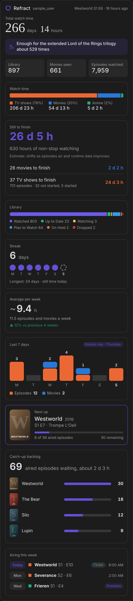

# Refract for Home Assistant

[](https://github.com/hacs/integration)
[](https://github.com/Big-Edge2297/ha-refract/releases/latest)
[](https://github.com/Big-Edge2297/ha-refract/actions/workflows/validate.yml)

Unofficial [Home Assistant](https://www.home-assistant.io) integration for [Refract](https://getrefract.app), the cross-media tracker for movies, TV and anime. It uses Refract's official [personal API keys](https://getrefract.app/developers).



- **Sensors** for your library, watch time, streak, last 7 days, average per week, catch-up backlog, what's next and what you watched last
- A **dashboard card** with all of that in one place, with optional posters
- A **calendar** of upcoming episodes for the shows you follow
- Your **watchlist** as a to-do list
- **Actions** to log what you watch from automations: mark an episode watched, log a movie, add to the watchlist and more

> Not affiliated with Refract. Use at your own risk and keep your key private.

## Installation

### HACS (recommended)

Refract is in the default [HACS](https://hacs.xyz) store, so no custom repository is needed.

[](https://my.home-assistant.io/redirect/hacs_repository/?owner=Big-Edge2297&repository=ha-refract&category=integration)

Or from within HACS:

1. Open **HACS** in Home Assistant.
2. Search for **Refract** and open it.
3. Click **Download**, then confirm.
4. **Restart Home Assistant**.
5. Go to **Settings > Devices & services > Add integration**, search for **Refract** and paste your API key.

[](https://my.home-assistant.io/redirect/config_flow_start/?domain=refract)

### Manual installation

1. Download the [latest release](https://github.com/Big-Edge2297/ha-refract/releases/latest).
2. Copy the `custom_components/refract` folder into your Home Assistant `config/custom_components/` directory.
3. Restart Home Assistant and add the integration as in step 5 above.

Requires Home Assistant **2025.1** or newer.

### Updating

Update through HACS, **restart Home Assistant**, then hard-refresh your browser (Ctrl+Shift+R, or Cmd+Shift+R on a Mac) so the dashboard card reloads. In the mobile app use **Settings > Companion app > Troubleshooting > Reset frontend cache**.

## Create your API key

In the Refract app: **Integrations > Access and connected apps > Create a key**. The key starts with `rfk_` and is shown **once**.

Pick the permissions for what you want Home Assistant to do. The integration only creates the entities and actions your key allows.

| Refract permission | What you get |
|---|---|
| See your public profile | Required. Used to validate the key; username sensor |
| See your library and the status of each title | Library counts, last watched, watchlist, calendar, airing this week |
| See what you watched and when | Stats, streak, next up, catch-up backlog, last 7 days, average per week |
| Add, remove and move titles in your library | `set_status`, `add_to_watchlist`, removing watchlist items |
| Mark episodes and movies as watched | `mark_episode_watched`, `log_movie_play`, `log_rewatch` and the card's **Mark watched** button |

Rating titles and editing lists aren't available yet because Refract's API doesn't offer them yet.

Keys can be revoked from the same screen. If a key is revoked, Home Assistant asks you to re-authenticate.

## Dashboard card

The card ships with the integration, with nothing extra to install. After installing or updating, restart Home Assistant, hard-refresh your browser, edit a dashboard, choose **Add card** and search for **Refract stats**.

```yaml
type: custom:refract-stats-card
entity: sensor.refract_<username>_next_up
```

Every section has its own switch (`show_average`, `show_last_7_days`, `show_catchup`, `show_airing`, `show_posters` and more), and there is a compact layout. See **[docs/dashboard-card.md](docs/dashboard-card.md)** for all options, the **Mark watched** button and troubleshooting.

## Options

**Settings > Devices & services > Refract > Configure**

| Option | Default | What it does |
|---|---|---|
| Update interval | 15 min | How often Refract is checked for changes |
| Fetch watch history | on | Needed for *Last 7 days* and *Average per week*. The history is refreshed at most hourly. For large libraries it is many requests (200 per page); turn it off to skip them |
| TMDB API key | empty | Optional. Adds posters. See below |

### Posters (optional)

Refract's API doesn't include images, so posters come from [TMDB](https://www.themoviedb.org):

1. Create a free account and get an API key at [themoviedb.org/settings/api](https://www.themoviedb.org/settings/api). Either the v3 API key or the v4 read access token works.
2. Paste it into the **TMDB API key** option.

Each show is looked up once and the result is cached on disk. Posters are loaded from `image.tmdb.org` by your browser, and your key stays in Home Assistant. Without a key the card simply shows no posters.

*This product uses the TMDB API but is not endorsed or certified by TMDB.*

## Entities

| Entity | Needs |
|---|---|
| `sensor.*_library_total`, `in_progress`, `watchlist`, `up_to_date`, `completed`, `movies`, `tv_shows`, `anime` | library |
| `sensor.*_last_watched` (timestamp, with title, season and episode) | library |
| `sensor.*_airing_this_week` (episodes airing in the next 7 days) | library |
| `calendar.*_upcoming_episodes` | library |
| `todo.*_watchlist` (items can be removed) | library |
| `sensor.*_shows_waiting`, `sensor.*_next_up` (with `poster_url` when a TMDB key is set) | history |
| `sensor.*_still_to_finish` (estimated time left for movies and shows not finished yet, with counts, episodes and started / not started per kind) | library |
| `sensor.*_catch_up` (aired episodes waiting across all shows, per-show counts and next episode, estimated minutes) | history |
| `sensor.*_last_7_days` (episodes and movies per day, busiest day) | history + fetch watch history |
| `sensor.*_average_per_week` (estimated hours per week, change against the 4 weeks before) | history + fetch watch history |
| `sensor.*_stats_*` (one per numeric field from your profile stats) | history |
| `sensor.*_username` (diagnostic) | profile |

## Actions

Every action takes one of `refract_id`, `tmdb_id`, `imdb_id` or `tvdb_id` (for shows, the **show's** id), and an optional `config_entry_id` if you have several accounts.

| Action | Extra fields |
|---|---|
| `refract.mark_episode_watched` | `season`, `number` (TMDB numbering), optional `watched_at`, `watched: false` to unmark |
| `refract.log_movie_play` | optional `watched_at` |
| `refract.log_rewatch` | `season`, `number`, optional `watched_at` |
| `refract.add_to_watchlist` | `media_type` (`movie`/`show`) |
| `refract.set_status` | `media_type`, `status` (`planned`, `in_progress`, `up_to_date`, `completed`) |

Example script:

```yaml
script:
  log_severance_s2e4:
    sequence:
      - action: refract.mark_episode_watched
        data:
          tmdb_id: 95396
          season: 2
          number: 4
```

Example: add a movie to your watchlist from a dashboard button or automation:

```yaml
action: refract.add_to_watchlist
data:
  media_type: movie
  imdb_id: tt1375666
```

To log playback from Plex, Jellyfin, Emby or Sonarr/Radarr, trigger these actions from their webhooks or events. You need the title's TMDB, IMDb or TVDB id, which those tools provide.

## Notes and limitations

- **Estimates:** Refract's history has dates but no runtimes, so *Average per week* and the catch-up time are estimated from your average runtime per item. They are marked as estimates.
- **Last 7 days** only counts watches that have a date recorded in Refract.
- **Large libraries:** library counts need the whole library (pages of 200), and the history is fetched hourly. A longer update interval, or turning off *Fetch watch history*, reduces requests. Refract allows 120 requests a minute.
- The response layouts of the history and calendar endpoints are parsed defensively. If a section looks wrong, please [open an issue](https://github.com/Big-Edge2297/ha-refract/issues) with a redacted sample response (remove your key and personal data).
- Ratings and list editing aren't available through Refract's API yet.

## Troubleshooting

| Problem | What to do |
|---|---|
| The card isn't in the card picker | Restart Home Assistant, then hard-refresh the browser |
| No *Last 7 days* / *Average per week* | Your key needs the "See what you watched and when" permission, and *Fetch watch history* must be on |
| No posters | Add a TMDB key in the options, wait for the next update, and check `show_posters` isn't `false` |
| Setup says the key is rejected | Check it was copied in full (it starts with `rfk_`) and wasn't revoked |

Enable debug logging when reporting a problem:

```yaml
logger:
  logs:
    custom_components.refract: debug
```

## Development

```bash
git clone https://github.com/Big-Edge2297/ha-refract
```

Copy or symlink `custom_components/refract` into your Home Assistant `config/custom_components/` folder and restart.

```bash
pip install pytest && python -m pytest -q tests       # history, backlog and calendar logic
cd frontend && npm ci && npm test && npm run build    # the dashboard card
```

The card's source is in `frontend/`; the built file is committed in `custom_components/refract/www/` and CI fails if it doesn't match. See [docs/dashboard-card.md](docs/dashboard-card.md#development).

Releases: tag `vX.Y.Z` to match `manifest.json`'s `version`, and add the changes to [CHANGELOG.md](CHANGELOG.md).

## License

MIT
