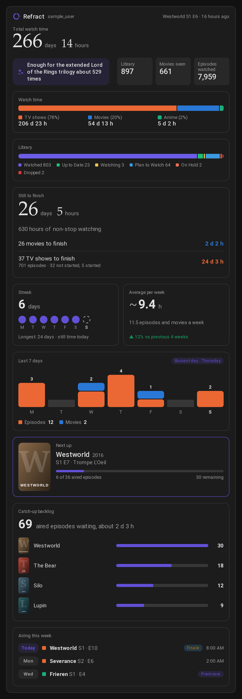

# Refract Stats Card

The dashboard card that ships with the [Refract integration](https://github.com/Big-Edge2297/ha-refract). It turns your Refract sensors into a readable card: how long you've watched, what's in your library, your streak, and what to watch next.



## What it shows

| Section | What you see | Needs |
|---|---|---|
| **Watch time** | Total time as days and hours, a library/movies/episodes watched summary, and the fun stat in a highlighted pill ("about 8.8 months of nonstop viewing") | profile stats |
| **Watch time split** | Shows, movies and anime as a stacked bar with readable durations and shares. Choose a compact bar with the share after each title, or a breakdown list with the time and share on one row per kind | profile stats |
| **Library** | Every status you use, named and colored as in the Refract app: Watched, Up to Date, Watching, Plan to Watch, On Hold, Dropped (and any other status Refract adds). Choose a compact bar with a legend, or the full breakdown list with counts and percentages | library |
| **Still to finish** | The time left to watch the movies and shows you haven't finished (Plan to Watch, Watching and On Hold), as in the Refract app: a total, the same in hours, and one row each for movies, TV shows and anime with the number of titles, episodes left and how many shows are started or not | library |
| **Streak** | Current streak in big numbers, seven day dots and your longest streak | profile stats |
| **Average per week** | Estimated hours per week over the last 4 weeks, how many episodes and movies that is, and the change against the 4 weeks before | watch history |
| **Last 7 days** | Episodes and movies per day as stacked bars, with the busiest day named | watch history |
| **Next up** | The show (with poster), episode number and name, progress through aired episodes, premiere or finale badges and an optional **Mark watched** button. Tap a show in the catch-up backlog to show it here instead | history |
| **Catch-up backlog** | How many aired episodes are waiting across all your shows, an estimate of the time, and the biggest backlogs as bars | history |
| **Airing this week** | Episodes airing in the next 7 days for the shows you follow, with premiere and finale pills and the air time when Refract knows it | library |

Sections hide themselves when their sensors don't exist, so a read-only API key still gives a clean card.

## Posters

Posters appear beside **Next up** and in the **Catch-up backlog** when you add a free [TMDB](https://www.themoviedb.org) API key to the integration: **Settings → Devices & services → Refract → Configure → TMDB API key**. Without a key the card shows no posters and nothing changes. A show without a poster shows its first letter instead.

Turn posters off in the card with `show_posters: false`.

## Installation

Nothing to install separately. The card is bundled with the integration and loads automatically.

1. Install or update the Refract integration (through HACS).
2. Restart Home Assistant.
3. Hard-refresh your browser (Ctrl+Shift+R, or Cmd+Shift+R on a Mac). In the mobile app, use **Settings → Companion app → Troubleshooting → Reset frontend cache**.
4. Edit a dashboard, choose **Add card** and search for **Refract stats**.

No dashboard resource needs to be added by hand.

Requires Home Assistant 2025.1 or newer.

### Coming from the standalone card?

Earlier versions of this card were a separate HACS download (`Big-Edge2297/ha-refract-card`). Your existing cards keep working with the same configuration. To avoid two copies loading:

1. In HACS, open **Refract Stats Card** under **Dashboard** and choose **Remove**.
2. Under **Settings → Dashboards → ⋮ → Resources**, delete any `refract-stats-card.js` entry that's still listed.
3. Restart Home Assistant and hard-refresh the browser.

If both copies are present, the first one loaded wins and the browser console shows a warning.

## Adding the card

Use the visual editor: **Edit dashboard → Add card → Refract stats**, then pick any entity from your Refract account. The card finds the rest on its own.

Or in YAML:

```yaml
type: custom:refract-stats-card
entity: sensor.refract_<username>_next_up
```

Replace `<username>` with your own: the entity ID is whatever your Refract entities are called in Home Assistant (check **Settings → Devices & services → Entities**). Any Refract entity works as the `entity`, and the card finds the other sensors of the same account. The visual editor avoids typing it at all.

### Choosing sections

Every section has an on/off switch. For example, a slimmer card without the weekly charts and the airing list:

```yaml
type: custom:refract-stats-card
entity: sensor.refract_<username>_next_up
show_average: false
show_last_7_days: false
show_airing: false
```

### Section order

Change the order of the sections in the editor under **Section order** (arrows move a section up or down), or in YAML with `section_order`. The header always stays on top. Sections you leave out of the list follow in their default position, and the `show_*` switches still decide what is shown.

```yaml
type: custom:refract-stats-card
entity: sensor.refract_sample_user_next_up
section_order:
  - next_up
  - airing
  - hero
```

The default order is `hero`, `watch_time`, `library`, `still_to_finish`, `streak`, `average`, `last_7_days`, `next_up`, `catchup`, `airing`. `streak` and `average` share a row when they are next to each other. The compact layout uses the same order for the sections it shows.

### Compact layout

```yaml
type: custom:refract-stats-card
entity: sensor.refract_<username>_next_up
layout: compact
```

## Configuration

| Option | Default | Description |
|---|---|---|
| `entity` | | **Required.** Any entity of the Refract account |
| `name` | from the device | Overrides the account name in the header |
| `layout` | `full` | `full`, or `compact` (watch time, streak and next up only) |
| `watch_time_style` | `bar` | `bar` (a stacked bar with the share after each title) or `list` (a bar plus one row per kind with its time and percentage, like the library list; taller) |
| `library_style` | `bar` | `bar` (a status bar with a legend) or `list` (the Refract app's status breakdown: a bar plus one row per status with its count and percentage; taller) |
| `duration_format` | `days_hours` | `days_hours` (206 d 23 h), `hours` (4,967 h) or `auto` (picks the unit by size) |
| `fun_stat` | `true` | Show the fun stat pill under the watch time |
| `fun_stat_mode` | `rotate` | `rotate` (changes daily), `months`, `workweeks` or `lotr` |
| `queue_length` | `5` | Catch-up rows shown before "Show all" |
| `airing_length` | `5` | "Airing this week" rows shown before "Show all" |
| `section_order` | see below | Order of the sections under the header (list of section names) |
| `show_hero` | `true` | Watch time summary and fun stat |
| `show_watch_time` | `true` | Watch time split |
| `show_library` | `true` | Library (status bar or breakdown list, see `library_style`) |
| `show_still_to_finish` | `true` | Still to finish |
| `show_streak` | `true` | Streak |
| `show_average` | `true` | Average per week |
| `show_last_7_days` | `true` | Last 7 days chart and busiest day |
| `show_next_up` | `true` | Next up tile |
| `show_catchup` | `true` | Catch-up backlog |
| `show_airing` | `true` | Airing this week |
| `show_posters` | `true` | Posters (needs a TMDB key in the integration options) |
| `show_actions` | `false` | Show the "Mark watched" button on the next up tile |
| `confirm_actions` | `true` | Ask for a second tap before marking watched |
| `config_entry_id` | | Only for "Mark watched" with several Refract accounts when you're not an admin |
| `color_movies` | `#2a78d6` | Movies color, used in every chart |
| `color_shows` | `#eb6834` | TV shows color |
| `color_anime` | `#1baf7a` | Anime color |
| `color_accent` | `#6250d6` | Progress bars, streak and next up highlight |
| `entities` | | Manual overrides for discovery, see below |

The compact layout shows only the watch time summary, streak and next up, and ignores the other `show_*` options.

### Options from earlier versions

| Option | What happens now |
|---|---|
| `show_queue` | Still works as an alias for `show_catchup` (unless `show_catchup` is also set) |
| `streak_style`, `show_streak_toggle` | Ignored. The streak is always shown as dots; the gauge is gone |

## Mark watched

The next up tile can mark the shown episode as watched. It is **off by default**, because it changes data in your Refract account.

Turn it on in the editor under **Next up actions**, or in YAML:

```yaml
type: custom:refract-stats-card
entity: sensor.refract_<username>_next_up
show_actions: true
```

The button calls the integration's `refract.mark_episode_watched` action. It stays hidden when that action isn't available (for example when the API key can't write) or when the next episode hasn't aired yet. The editor warns you in that case.

### Marking an episode of another show

Next up normally shows one show. To mark an episode of a different show you're watching, tap its row in the **Catch-up backlog**. The Next up tile switches to that show and its next episode, and the **Mark watched** button works on it. After you mark it, the tile stays on that show and moves on to its following episode, so you can mark several in a row. To return to the show the tile started with, tap its row in the backlog (it becomes tappable while another show is shown), or tap the picked row again. The tile also returns by itself once the show has nothing left in the backlog.

Rows can be tapped only while **Next up** is shown, and only when the integration knows the show's next episode. The show already in Next up can't be tapped, because it is already there. The choice is not saved: reloading the dashboard returns to the default show. This needs integration 0.3.8 or newer for every row; with an older integration only the first few shows in the backlog can be picked.

With `confirm_actions` on (the default), the first tap changes the button to "Mark watched?" for three seconds and the second tap does it. After a successful call the card asks Home Assistant to refresh the Refract sensors; they update as soon as Refract responds.

## How the card finds your sensors

The card takes the entity you chose and finds the other Refract sensors of the same account:

1. Through the device registry: every Refract sensor on the same device.
2. By name: `sensor.<prefix><key>`, where the prefix comes from the entity you chose (for `sensor.refract_<username>_next_up` the prefix is `refract_<username>_`).

Sensors you renamed keep working through the first method. If something still isn't picked up, point the card at it directly:

```yaml
type: custom:refract-stats-card
entity: sensor.refract_<username>_next_up
entities:
  completed: sensor.my_completed_titles
  stats_streak_current_days: sensor.my_streak
```

The keys are `library_total`, `completed`, `in_progress`, `watchlist`, `up_to_date`, `movies`, `tv_shows`, `anime`, `last_watched`, `shows_waiting`, `next_up`, `catch_up`, `last_7_days`, `average_per_week`, `airing_this_week`, `stats_watch_time_total_minutes`, `stats_watch_time_shows_minutes`, `stats_watch_time_movies_minutes`, `stats_watch_time_anime_minutes`, `stats_shows_episodes_watched`, `stats_anime_episodes_watched`, `stats_movies_watched`, `stats_streak_current_days` and `stats_streak_longest_days`.

### Several accounts

Add one card per account and pick an entity from each.

## Good to know

- **Streak dots are inferred.** The sensors have no per-day history, so the seven dots are worked out from the streak length and the time of your last watch. If you watched yesterday but not yet today, today's dot is dashed and the card says there's still time. Days follow the time zone preference in your Home Assistant profile (browser or server).
- **Average per week is an estimate.** Refract's history gives dates but not runtimes, so the hours are the number of episodes and movies you watched in the last 4 weeks, multiplied by your average runtime per item (total watch time divided by titles watched). It's marked with a `~`. The percentage compares the last 4 weeks with the 4 weeks before, and is left out unless that earlier period had at least 4 viewings, so a quiet stretch doesn't make a normal month look like a huge jump.
- **Air times** follow your Home Assistant time zone and 12/24 hour setting. The day chip uses the day Refract reports, so for a show airing late in the evening it can differ from your local day if your Home Assistant time zone differs from the one in your Refract profile.
- **Last 7 days** counts the days Refract has on record. Episodes watched with no date recorded can't appear in it. The busiest day is the day with the most episodes and movies in those seven days (the latest day wins a tie).
- **Watch history is refreshed hourly**, and straight after you mark something watched through Home Assistant. Turn it off in the integration options if you don't want the extra requests; the two sections that need it then disappear.
- **The catch-up backlog** counts aired episodes you haven't watched across every show you're watching, including the one shown as next up. The time is an estimate from your average episode length.
- **The library** lists every status that has at least one title, taken from the `by_status` attribute of the library total sensor. Statuses are named as in the Refract app (Watched, Up to Date, Watching, Plan to Watch, On Hold, Dropped) and ordered the same way; any other status Refract adds follows with a readable name, and "paused" counts as on hold. Percentages in the list are each status's share of the titles listed. If the `by_status` attribute is missing, for example with an older integration version, the card shows the four main statuses plus **Other**, the difference between your library total and their sum, so the bar always adds up. The app's *Rewatched* line isn't shown, because the integration doesn't have that number yet.
- **Last 7 days** shows the number of episodes watched above each bar (days with no episodes show no number); movies are the blue part of the bar.
- **Episodes watched** in the summary is TV episodes plus anime episodes.
- **Still to finish** adds up the titles in your library that are *Plan to Watch*, *Watching* or *On Hold*; completed, up to date and dropped titles don't count. For shows you've started, the episodes are the aired ones you haven't watched (the same numbers as the catch-up backlog). For shows you haven't started, the integration needs an episode count from the library item. If Refract doesn't provide one, the show is counted but left out of the episodes and the time, and the card says how many shows that is. Time uses the runtime Refract gives for a title when there is one, otherwise your average runtime per movie or episode, and is then an estimate. It may differ a little from the Refract app, and it changes as episodes air. Anime has its own row only when you have anime to finish.
- **The fun stat** needs at least a day of watch time. In `rotate` mode it changes once a day.

## Styling

The card follows your Home Assistant theme. These optional theme variables override its defaults:

| Variable | Used for |
|---|---|
| `--refract-color-movies`, `--refract-color-shows`, `--refract-color-anime` | Category colors |
| `--refract-color-accent` | Progress, streak, next up |
| `--refract-color-completed`, `--refract-color-up-to-date`, `--refract-color-in-progress`, `--refract-color-watchlist`, `--refract-color-on-hold`, `--refract-color-dropped` | Library colors for Watched, Up to Date, Watching, Plan to Watch, On Hold and Dropped. The defaults match the Refract app |
| `--refract-tile-background` | Summary tiles |
| `--refract-hero-font` | The large watch time numbers |

## Troubleshooting

**The card isn't in the card picker, or "Custom element doesn't exist: refract-stats-card"**: restart Home Assistant after updating the integration, then hard-refresh the browser. The file is served from `/refract_card/refract-stats-card.js`; opening that address while logged in should show JavaScript. If it's missing, check the Home Assistant log for "Refract card file not found".

**"Couldn't find any Refract entities"**: the chosen entity isn't from the Refract integration, or its sensors are unavailable. Pick an entity from the Refract device, or use the `entities` option.

**A section is missing**: its sensors don't exist for your API key, or are unavailable. Check Developer Tools → States for the sensor. *Last 7 days* and *Average per week* also need **Fetch watch history** turned on in the integration options.

**No posters**: add a TMDB API key under **Settings → Devices & services → Refract → Configure**, wait for the next update (up to the update interval), and check that `show_posters` isn't `false`. Posters are loaded from `image.tmdb.org` by your browser, so an ad blocker or a restrictive network can hide them; the card then shows the first letter of the title.

**No "Mark watched" button**: `show_actions` is off (the default), the `refract.mark_episode_watched` action isn't available, or the next episode hasn't aired.

## Development

The card's source lives in `frontend/`. The built file is committed at `custom_components/refract/www/refract-stats-card.js`, which is what Home Assistant serves.

```bash
cd frontend
npm install
npm run typecheck   # TypeScript
npm test            # unit and DOM tests
npm run build       # writes ../custom_components/refract/www/refract-stats-card.js
npm run demo        # preview with sample data at http://localhost:5173
```

The demo page has a theme switch, a width slider, a posters switch and options for layout and duration format. It replaces Home Assistant's own elements with simple stand-ins, so fonts and icons look slightly different from the real thing.

After changing anything in `frontend/src`, run `npm run build` and commit the updated file in `www/`. CI fails if it doesn't match the source. The card version is the `version` in `frontend/package.json`; the browser cache is busted by the integration's own version, so bump `manifest.json` for each release.

### Translations

All text is in `frontend/src/localize.ts`. To add a language, add a dictionary keyed by the two-letter language code and register it in `dictionaries`. Missing keys fall back to English.

## License

Same as the integration.
